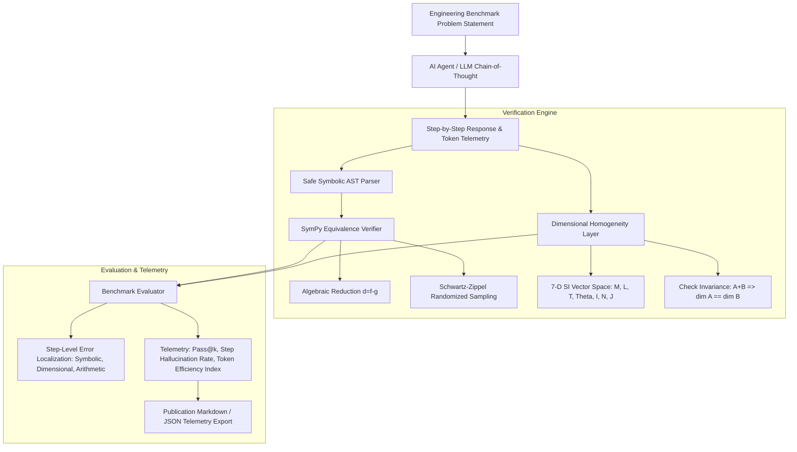

# `agent-engineering-benchmark`

[](https://www.python.org/downloads/)
[](https://opensource.org/licenses/MIT)
[](https://docs.pytest.org/)
[](#ai-collaboration-disclosure)

A rigorous automated evaluation and benchmarking harness for LLMs and autonomous code agents on multi-step engineering mathematics, physical dimensional consistency, and optimization formulations. Features symbolic equivalence checking via SymPy and step-level hallucination localization.

---

## AI Collaboration Disclosure

> **Notice:** This repository was developed with AI assistance using **Gemini Flash**. The core objectives are:
> 1. Testing and evaluating AI agent benchmarking harnesses on rigorous scientific and engineering tasks.
> 2. Deliberate practice of building symbolic CAS evaluation pipelines, physical dimensional validation, and telemetry analytics.
> 3. Revising physical dimensional analysis, computer algebra systems, and combinatorial evaluation metrics (`pass@k`) from first principles.

---

## Architecture Overview



---

## Mathematical & Algorithmic Foundations

### 1. Symbolic Equivalence vs. String Matching
Exact string matching fails on mathematically equivalent expressions with different factorizations or permutations.
The engine tests $d(\mathbf{x}) = f(\mathbf{x}) - g(\mathbf{x}) \equiv 0$ through:
1. `simplify(d) == 0`
2. `expand(d) == 0`
3. `trigsimp(d) == 0`
4. `factor(d) == 0`
5. **Schwartz-Zippel Lemma:** For transcendental or non-elementary difference forms, evaluates $K$ random positive points in $\mathbb{R}_{>0}^M$. If $|d(\mathbf{r}_k)| < \epsilon = 10^{-7}$ for all $k$, equivalence is established with bounded error probability.

### 2. 7-Dimensional SI Physical Vector Space
Every physical dimension is represented as an integer exponent tuple:
$$
\mathbf{d} = (\alpha, \beta, \gamma, \delta, \epsilon, \zeta, \eta) \in \mathbb{Z}^7 \implies [Q] = [M]^\alpha [L]^\beta [T]^\gamma [\Theta]^\delta [I]^\epsilon [N]^\zeta [J]^\eta
$$
- **Addition Invariance:** $[A + B] \implies \mathbf{d}_A = \mathbf{d}_B$
- **Transcendental Arguments:** Arguments to $\sin, \cos, \exp, \ln$ must satisfy $\mathbf{d} = \mathbf{0}$.

### 3. Unbiased Pass@k Metric
$$
\text{pass}@k = \mathbb{E}\left[ 1 - \frac{\binom{n-c}{k}}{\binom{n}{k}} \right]
$$

---

## Benchmark Results (5 Multi-Step Engineering Domains)

Evaluated across Structural Mechanics, Fluid Dynamics, Thermodynamics, Electrical Engineering, and Dynamics & Control:

| Agent Model | Exact String Match | Symbolic Accuracy | End-to-End Pass Rate | Step Hallucination Rate | Reasoning Tokens / Step |
|---|---|---|---|---|---|
| **Gemini-Flash-Engineering** | 83.3% | **100.0%** | **100.0%** (5/5) | **0.0%** | **186 tokens/step** |
| **Baseline-LLM** | 83.3% | 75.0% | 80.0% (4/5) | 16.7% | 402 tokens/step |

*Key finding: Raw string matching underreports true mathematical capabilities by 16.7% due to harmless algebraic reorderings, while failing to catch dimensional violations.*

---

## Quickstart

```python
from agent_benchmark.symbolic import SymbolicVerifier
from agent_benchmark.dimensional import DimensionalChecker, DimensionVector
from agent_benchmark.harness import get_standard_engineering_suite, BenchmarkEvaluator

# 1. Verify Symbolic Equivalence
gt = "(P * L**3) / (3 * E * I)"
candidate = "(1/3) * (P / E) * (L**3 / I)"
is_equiv = SymbolicVerifier.verify_equivalence(candidate, gt)
print("Equivalent:", is_equiv)  # True

# 2. Check Dimensional Homogeneity
sym_dims = {"P": "force", "L": "length", "E": "pressure", "I": DimensionVector(l=4)}
dim = DimensionalChecker.infer_dimension(candidate, sym_dims)
print("Dimension:", dim.to_symbolic_string())  # [L]

# 3. Evaluate Agent Attempt
suite = get_standard_engineering_suite()
eval_res = BenchmarkEvaluator.evaluate_attempt(suite[0], agent_attempt)
print("Solved:", eval_res.all_steps_correct)
```

---

## Directory Structure

```text
agent-engineering-benchmark/
├── docs/
│   ├── 01_symbolic_equivalence_engine.md
│   ├── 02_dimensional_analysis_verification.md
│   └── 03_benchmark_harness_and_telemetry.md
├── notebooks/
│   ├── 01_benchmark_walkthrough.ipynb
│   └── run_benchmark_eval.py
├── src/
│   └── agent_benchmark/
│       ├── __init__.py
│       ├── dimensional/
│       │   ├── __init__.py
│       │   ├── dimensions.py
│       │   └── unit_checker.py
│       ├── harness/
│       │   ├── __init__.py
│       │   ├── evaluator.py
│       │   ├── problem.py
│       │   └── suite.py
│       ├── symbolic/
│       │   ├── __init__.py
│       │   ├── parser.py
│       │   └── verifier.py
│       └── telemetry/
│           ├── __init__.py
│           ├── metrics.py
│           └── reporter.py
├── tests/
│   ├── conftest.py
│   ├── test_dimensional_checker.py
│   ├── test_evaluator.py
│   ├── test_symbolic_verifier.py
│   └── test_telemetry.py
├── pyproject.toml
├── .gitignore
├── LICENSE
└── README.md
```

---

## Verification & Testing

```bash
pytest -v
```
All 13 unit tests pass verifying symbolic identities, 7D SI dimension algebra, dimensional violation detection, step error localization, and pass@k combinatorics.
