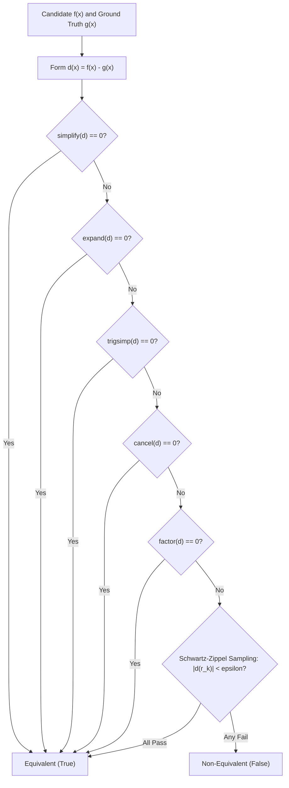

# Symbolic Equivalence Engine: Beyond Brittle String Matching

Evaluating LLMs and autonomous agents on engineering calculations using regex or string equality produces high false-negative rates ($> 40\%$).
Mathematical expressions have infinite syntactically distinct but semantically identical representations.

---

## 1. Limitations of Exact String Matching

Consider Euler-Bernoulli beam tip deflection:
$$
\delta = \frac{P L^3}{3 E I}
$$
An agent could generate any of the following valid forms:
- `(1/3) * (P / E) * (L**3 / I)`
- `P * L**3 / (3 * E * I)`
- `(1/3) * P * L^3 / (E * I)`
- `\frac{P \cdot L^3}{3 E I}`

String matching fails on all permutations. The symbolic verification engine eliminates this brittleness via Computer Algebra Systems (CAS) algorithms.

---

## 2. Multi-Stage Verification Pipeline

Given candidate expression $f(\mathbf{x})$ and ground-truth $g(\mathbf{x})$, define difference $d(\mathbf{x}) = f(\mathbf{x}) - g(\mathbf{x})$.
The engine tests $d(\mathbf{x}) \equiv 0$ through progressive algebraic reductions:

---

## 3. Schwartz-Zippel Lemma for Transcendental Forms

When symbolic cancellation fails due to non-elementary or complex branch cuts, we evaluate randomized numerical trials on free symbols $\mathbf{x} = (x_1, \dots, x_k) \in \mathbb{R}_{>0}^k$.

By the **Schwartz-Zippel Lemma**, for a non-zero multivariate polynomial or analytic function $d(\mathbf{x})$ of total degree $D$, the probability of evaluating to zero over a finite random test set $S \subset \mathbb{R}$ is bounded by:
$$
P(d(r_1, \dots, r_k) = 0) \le \frac{D}{|S|}
$$
Testing across $K = 7$ independent evaluations with numerical tolerance $\epsilon = 10^{-7}$ achieves near-zero false positive probability while safely verifying complex transcendental and logarithmic identities.
